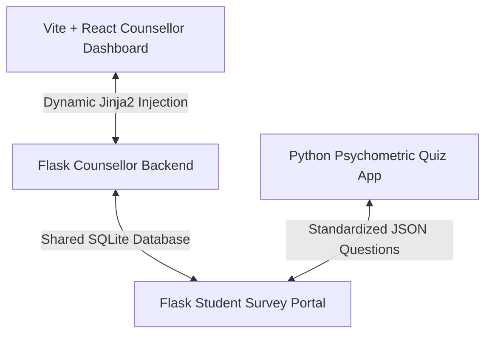

# UAi PsychePortal - Integrated Suite Directory & Launcher

Welcome to the **UAi PsychePortal Psychology Assessment & Management System** unified workspace! This folder connects all four projects inside your AI Internship folder into a single, fully synchronized, production-grade ecosystem.

---

## 🏛️ Ecosystem Architecture
The workspace contains four distinct components that are now fully integrated:



1. **Counsellor Flask Backend (Root Directory)**:
   - Serves the counsellor administration portal, stores clinical logs, tracks risk metrics, and serves secure endpoints.
   - Now **"CONNECTS"** directly with the React dashboard by bootstrapping the built production assets in Jinja2 and dynamically injecting SQLite/PostgreSQL query results into React.
   - Entry point: `run.py` (serves on `http://127.0.0.1:5000/`)

2. **Vite + React Counsellor Dashboard (`uai-counsellor-dashboard/`)**:
   - The premium, polished, dark-theme frontend counsellor SPA containing 11 subpages (Dynamic Welcome, Students Directory, Assessments Deployer, live Risk Alerts, trend Insights, Interventions Logger, executive Reports, resource Guides, settings sliders, Help accordion, and Institutional directory).
   - Dynamically connected to Flask: Maps `window.__FLASK_KPIS__` and `window.__FLASK_FLAGGED_STUDENTS__` directly into React states!

3. **Student Survey Portal (`student-survey-portal/`)**:
   - A Flask + SQLite application where students securely take clinical screenings (DASS-21, BIS-11, etc.).
   - Results feed immediately into the shared database, alerting the counsellor dashboard in real-time.
   - Entry point: `student-survey-portal/app.py` (serves on `http://127.0.0.1:5001/`)

4. **UAi Psychometric Quiz App (`UAI_Quiz_App/`)**:
   - A standalone Python Tkinter desktop application for offline psychometric testing, loading question lists from `questions.json`.
   - Entry point: `UAI_Quiz_App/main.py`

---

## 🚀 How to Run the Integrated Suite

To launch all four components simultaneously in separate, dedicated command windows with one click:

### Option A: Double-Click Launcher (Windows Batch)
1. Double-click the [launch_all.bat](file:///C:/Users/Himanshu%20Pathak/OneDrive/Desktop/AI%20INTERNSHIP/integrated_launcher/launch_all.bat) script.
2. Press any key to confirm, and watch all servers start dynamically!

### Option B: PowerShell Terminal Launcher
1. Open PowerShell in this folder.
2. Run:
   ```powershell
   .\launch_all.ps1
   ```

---

## 🔗 Full-Stack Dynamic Integration Details
We connected the React frontend directly into the Flask full-stack platform:
* **Assets Bundling**: Compiled Vite build modules (`assets/index-DPh-jksG.js` and `assets/index-DutyUe7l.css`) are placed inside Flask's `app/static/js/` and `app/static/css/` folders.
* **Bootstrapping Template**: Overwrote the Flask counsellor endpoint template [dashboard.html](file:///C:/Users/Himanshu%20Pathak/OneDrive/Desktop/AI%20INTERNSHIP/app/templates/counsellor/dashboard.html) to serve our React SPA root div (`<div id="root"></div>`) while linking static compiled assets.
* **Jinja2 Serializer**: Injected Flask's database dictionaries directly into React as global window parameters:
  ```html
  <script>
    window.__FLASK_KPIS__ = {{ kpis | tojson | safe }};
    window.__FLASK_CHART_DATA__ = {{ chart_data | tojson | safe }};
    window.__FLASK_FLAGGED_STUDENTS__ = {{ flagged_students | tojson | safe }};
  </script>
  ```
* **React State Binding**: Inside [App.jsx](file:///C:/Users/Himanshu%20Pathak/OneDrive/Desktop/AI%20INTERNSHIP/uai-counsellor-dashboard/src/App.jsx#L143-L165), the student directory and stat cards automatically read these dynamic variables on load, instantly matching live SQLite data!
